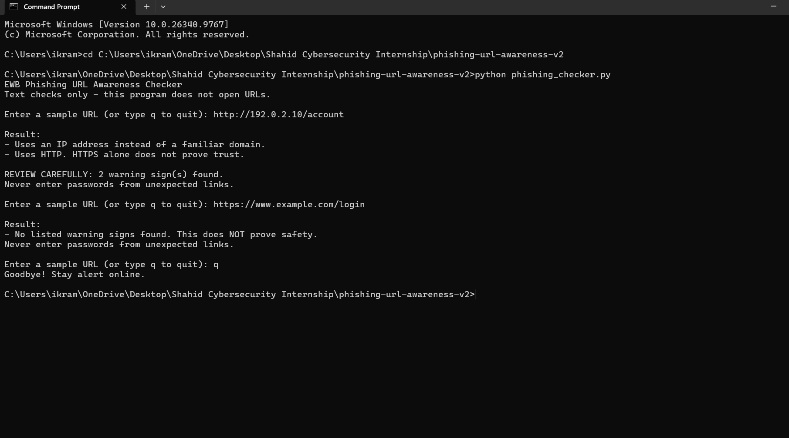
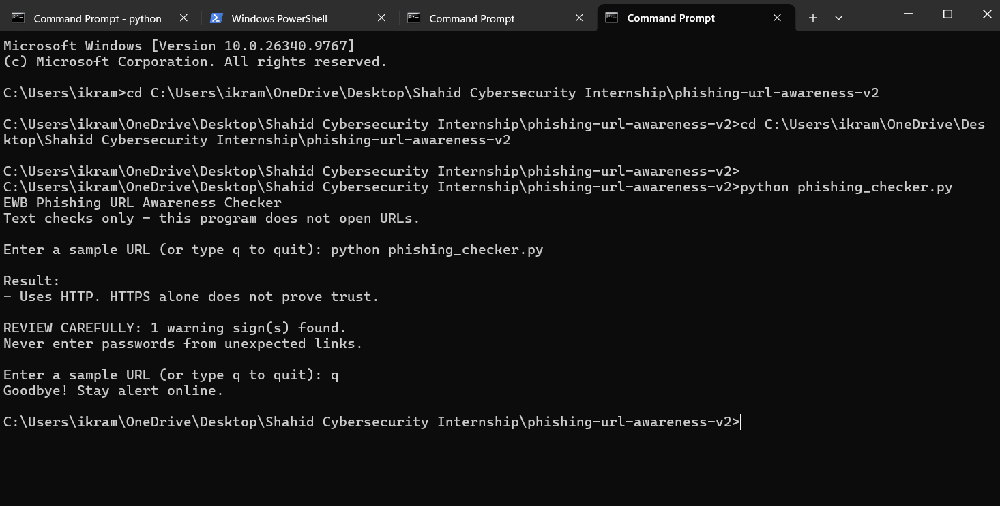

# EWB Phishing URL Awareness Checker

## Overview
Phishing uses fake links or messages to trick people into sharing sensitive information, such as passwords or payment details.

This Python program checks URL text for six selected warning signs and displays its findings. It does not open links, visit websites or send information anywhere.

The project is an educational awareness tool. It cannot prove whether a URL is safe or malicious.

## Features
- Detects an `@` symbol in the URL.
- Flags unusually long URLs containing more than 100 characters.
- Flags IPv4-shaped hostnames.
- Flags many hostname segments: five or more nonempty parts.
- Flags the punycode-style marker `xn--` in the hostname.
- Flags the HTTP scheme.
- Allows repeated checks without restarting the program.
- Supports `q`, `quit` and `exit` commands.
- Displays a REVIEW CAREFULLY summary with the warning count.
- Handles selected malformed inputs with a friendly message.
- Excludes information and input-error messages from the warning count.

## Requirements
Python 3.10 or later. No extra packages are required.
The program uses Python's standard-library modules `re` and `urllib.parse`.

My testing environment:
- Python version: 3.10+
- Operating system: Windows
- Testing date: October 2026

## How to Run
1. Open the `phishing-url-awareness` project folder in VS Code.
2. Select Terminal, then New Terminal.
3. Make sure the terminal is in the project folder.
4. Run the appropriate command.

Windows:
```text
python phishing_checker.py
```
If using the Python launcher on Windows:
```text
py phishing_checker.py
```
Mac/Linux:
```text
python3 phishing_checker.py
```

5. Enter a workbook sample URL when prompted.
6. Read the findings and warning-count summary.
7. Enter another sample to continue.
8. Type `q`, `quit` or `exit` to stop.

## Example Output
Example using `http://192.0.2.10/account`:
```text
EWB Phishing URL Awareness Checker
Text checks only - this program does not open URLs.

Enter a sample URL (or type q to quit): http://192.0.2.10/account

Result:
- Uses an IP address instead of a familiar domain.
- Uses HTTP. HTTPS alone does not prove trust.

REVIEW CAREFULLY: 2 warning sign(s) found.
Never enter passwords from unexpected links.

Enter a sample URL (or type q to quit): q
Goodbye! Stay alert online.
```

## Testing
Python version used: 3.10+  
Operating system: Windows  
Date: October 2026

A test passes when the actual findings match the expected findings. PASS does not mean that a URL is safe.

| # | Input | Expected | Actual | Result |
|---|-------|----------|--------|--------|
| 1 | `https://www.example.com/login` | No listed warning signs; not proof of safety | No listed warning signs found. This does NOT prove safety. | PASS |
| 2 | `http://192.0.2.10/account` | IP-address warning and HTTP warning | Uses an IP address instead of a familiar domain. Uses HTTP. HTTPS alone does not prove trust. | PASS |
| 3 | `http://example.com@sample.invalid/login` | `@` symbol warning and HTTP warning | Contains an `@` symbol; inspect carefully. Uses HTTP. HTTPS alone does not prove trust. | PASS |
| 4 | `https://a.b.c.d.e.example.invalid/path` | Many hostname segments warning | Contains many hostname segments/subdomains. | PASS |
| 5 | `https://xn--example.invalid/` | Punycode-style hostname warning | Contains a punycode-style hostname. | PASS |

The full test record is in `tests/test_samples.md`.

### Retesting After Improvements
I ran the five original samples again after adding Improvements A, B and C. The original warning findings remained unchanged.

| # | Sample | Actual findings and summary after improvements | Result |
|---|--------|-----------------------------------------------|--------|
| 1 | `https://www.example.com/login` | No listed warning signs found. This does NOT prove safety. No REVIEW CAREFULLY summary appeared. | PASS |
| 2 | `http://192.0.2.10/account` | IP-address and HTTP warnings appeared. The summary showed 2 warning signs. | PASS |
| 3 | `http://example.com@sample.invalid/login` | `@` symbol and HTTP warnings appeared. The summary showed 2 warning signs. | PASS |
| 4 | `https://a.b.c.d.e.example.invalid/path` | The hostname-segments warning appeared. The summary showed 1 warning sign. | PASS |
| 5 | `https://xn--example.invalid/` | The punycode-style warning appeared. The summary showed 1 warning sign. | PASS |

### Additional Improvement Tests
| Check | Expected | Actual | Result |
|-------|----------|--------|--------|
| Enter several samples in one session | Another input prompt appears after each result | The program accepted several samples without restarting. | PASS |
| Enter `q` | The program ends with a goodbye message | Goodbye! Stay alert online. | PASS |
| Enter `http://[bad` | A friendly invalid-format message appears | This text is not a valid URL format. The program continued to the next input prompt. | PASS |
| Check the summary for the malformed input | The input error is not counted as a warning | No REVIEW CAREFULLY summary appeared. | PASS |

## Screenshots




## Improvements

### 1. Repeated Checks and Quit Command — Option A
I added a `while` loop so the user can check several sample URLs without restarting the program. The user can type `q`, `quit` or `exit` to end the session.
This makes the program easier to use when checking several sample strings.
I tested this by entering more than one sample in the same session and then entering `q`. The program accepted the samples and ended with the goodbye message.

### 2. Review Carefully Summary — Option B
I added a REVIEW CAREFULLY summary that displays the number of warning signs found.
A helper function separates warnings from information and input-error messages. The malformed-input message from Improvement C is also excluded from the warning count.
I tested the summary using the five original samples. Samples 2 and 3 showed 2 warnings each. Samples 4 and 5 showed 1 warning each. Sample 1 did not show a review summary.

### 3. Malformed-Input Handling — Option C
I added a `try/except` block around URL parsing. If parsing raises a `ValueError`, the program returns a friendly message instead of stopping with the demonstrated parsing traceback.
I tested the workbook sample `http://[bad`. The program displayed "This text is not a valid URL format." and continued to the next input prompt. The message was not counted as a warning.
This improvement handles the demonstrated parsing-error case. It does not fully validate every possible URL.

## Limitations
This is an educational tool. It only reads URL text. It does not visit URLs, scan for malware, follow redirects or contact reputation services.
No listed warning signs found does NOT mean a URL is safe. Warning signs do not prove that a URL is malicious.
Other limitations include:
- HTTPS alone does not prove that a website is trustworthy.
- The IP-address regex detects an IPv4-like shape, not valid numeric ranges. It does not detect IPv6 hostnames.
- An `@` symbol in a path or query may also be flagged even when it does not affect the hostname.
- Counting hostname segments does not identify the registered domain or accurately count actual subdomains.
- The `xn--` marker check does not validate punycode or detect every look-alike hostname.
- Legitimate URLs can contain some of the listed warning signs.
- Adding `http://` when a scheme is missing is a parsing assumption, not evidence of the website's real protocol.
- Selected parsing errors are handled, but the program is not a complete URL validator.
- Passing these sample tests does not prove that the program can detect all phishing URLs.

## Ethical Use
Use workbook sample strings for demonstrations. Do not collect credentials, send phishing messages or use this project to deceive anyone.
Do not open suspicious links to test them. Do not scan or probe websites or networks without permission.
Never upload passwords, tokens or private information. Do not claim that this program can prove a URL is safe.
The baseline code, sample inputs and improvement examples are based on the EWB Courses Cybersecurity Mini Project Workbook.

## Author
Name: AHMED SHAHID  
Batch / Course: AI-POWERED CYBERSECURITY INTERNSHIP  
Programme: EWB Courses  
GitHub username: ahmedshahid-ai
